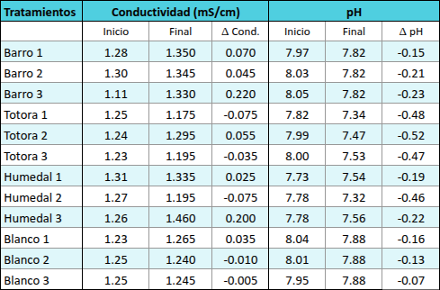
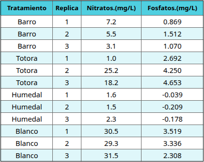
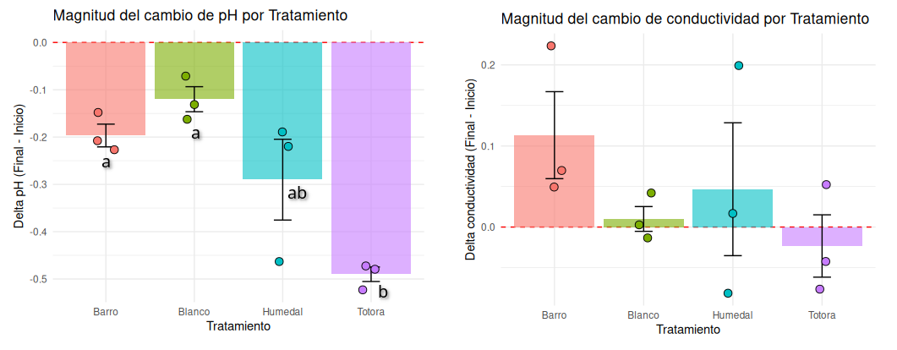
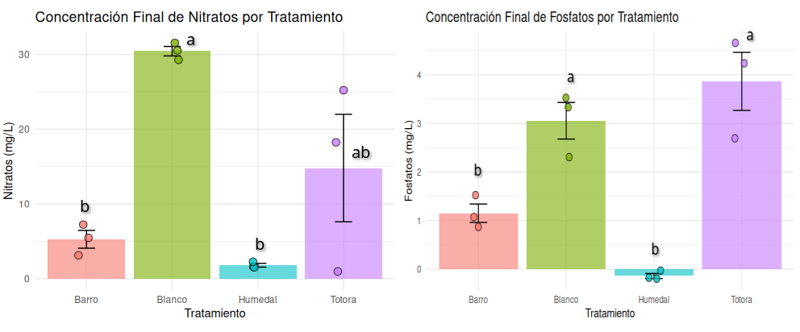

---
cssclasses:
bibliography: /home/ivan.fed/Zotero/bibliotecas/Biogeoquimica.json
reference-section-title: Bibliografía
csl: /home/ivan.fed/Zotero/styles/apa.csl
---
  
# Humedales y evaluación de biorreactores

Garcia Escobar, Iván Maximiliano¹\*
_¹Facultad de Ciencias Exactas y Naturales, Universidad Nacional de Cuyo, Mendoza 5500, Argentina_
\*ivangarescobar@gmail.com
Fecha: 30/04/2026
## Introducción

Los humedales son ecosistemas caracterizados por tener agua en la superficie o cerca de ella durante al menos una parte del año, lo que genera suelos hídricos que presentan condiciones de anoxia de forma intermitente o permanente [@SchlesingerBiogeochemistry]. 
Las condiciones de inundación y saturación del suelo genera algunas características como acumulación de materia orgánica y amplios gradientes de oxido-reducción, en estas condiciones las interacciones entre suelos hídricos, plantas hidrófitas y microorganismos asociados producen una variedad de transformaciones químicas en el sustrato [@hernandezBacteriasHumedales2018]. 
Entre las transformaciones químicas se pueden mencionar la nitrificación aeróbica (en zonas oxigenadas como la superficie y raíces) seguida de desnitrificación anaeróbica donde algunas bacterias utilizan el nitrato ($NO_3^-$) como aceptor final de electrones al oxidar la materia orgánica reduciéndolo a nitrógeno elemental y oxido nitroso ($N_2$​ y $N​_2O$). Además el $NO_3^-$ es asimilado metabólicamente por las plantas y otros microorganismos [@plazadelosreyesdelrioConsideraciones2011]. 
En cuando a la dinámica del fósforo se produce el fenómeno físico de adsorción, que implica la retención (y liberación según las condiciones) al formar un complejo con las arcillas del suelo. Las arcillas tienen carga negativa superficial que atrae cationes y estos interactúan con aniones, en particular con los fosfatos (${PO_4}^{3-}$) que son los aniones de mayor afinidad de adsorción [@SchlesingerBiogeochemistry]. El ${PO_4}^{3-}$ también es asimilado por plantas y microorganismos para sus funciones metabólicas.
Hay reacciones en los humedales que pueden generar un suministro de ${PO_4}^{3-}$ en  suelos que tienen una composición alta de hidróxidos de hierro y aluminio, al producirse la reducción de estos minerales en condiciones de anoxia se genera la liberación de iones ${PO_4}^{3-}$ al medio.
En cuanto a las reacciones que mas afectan el nivel de pH se pueden mencionar la reducción de hidróxidos de hierro (de $Fe^{3+}$ a $Fe^{2+}$) y la reducción del azufre de sulfatos a sulfuro de hidrógeno (${SO_4}^{2-} \Rightarrow H_2S$), ambas producen un aumento del pH al consumir protones $H^+$ presentes en el medio acuoso. Por otro lado la respiración radicular que libera $CO_2$ en medio acuoso se convierte en ácido carbónico y luego en bicarbonato liberando protones: $CO_2 + H_2O \rightleftharpoons H_2CO_3 \rightleftharpoons HCO_3^- + H^+$ lo que que reduce el pH. 

Figura 1: esquema de reacciones físico-químicas en humedales.

En este trabajo se busca evaluar el potencial depurador de biorreactores que emulan las condiciones de humedales usando como vegetación hidrófita a *Typha sp* "Totora" con su sustrato natural asociado a la rizósfera donde se encuentran los microorganismos. 
Como hipótesis se plantea que en el el biorreactor se producirán reacciones similares a las que suceden en humedales. Al simular una situación de una afluencia de nitratos y fosfatos en alta concentración que deriven o se hayan filtrado de un cause de uso agrícola, el sistema será capaz de depurarlo debido a las reacciones de desnitrificación, adsorción de fosfatos en arcillas y absorción metabólica por parte de la vegetación y los microorganismos.
Se plantean como predicciones encontrar luego de un mes:
- En los biorreactores que simulan un humedal con totoras y sustrato se espera encontrar muy baja conductividad y concentración de fertilizantes ($NO_3^-$ y ${PO_4}^{3-}$), y valores de pH relativamente altos.
- En el tratamiento que tiene solo totora o solo barro se espera valores intermedios de conductividad y de fertilizantes, ademas de valores de pH relativamente bajos.
- En el tratamiento de totora se espera tener valores de pH menor que en los tratamientos de barro.
- En el control se espera tener la mayor conductividad y concentración de $NO_3^-$ y ${PO_4}^{3-}$.

## Métodos y materiales
- Baldes de 5L para construir biorreactores 
- Serrucho y tijera de podar
- Panel lumínico (tubos fluorescentes)
- Totoras vivas con rizomas
- Tierra limo-arcillosa
- Timer para control de fotoperíodo
- Sales de nitrato y fosfato 
- pH-metro
- Espectrofotómetro HACH DR 2800 
- Balanza analítica 

Las totoras fueron recolectadas del parque San Martín (Ciudad de Mendoza) con rizomas y el suelo que rodea la rizósfera. A todas se les cortan las hojas a 20 cm de alto desde la base del rizoma y se toman 6 plantas para eliminar el sustrato que rodea la rizósfera lavando con agua corriente.
Para armar los biorreactores se usaron baldes de 5 L como contenedores, se preparó para los tratamientos la solución que contiene los fertilizantes (fosfatos y nitratos) y tierra arcillosa. Todos los tratamientos se realizaron por triplicado.
Como fertilizantes se usaron sales de $NO_3^-$ y ${PO_4}^{3-}$ con concentraciones de 100 mg/L y 20 mg/L respectivamente las cuales superan los limites aceptables en agua para consumo humano [@CodigoAlimentarioArgentino2018]. 

| Tratamiento | Descripción                                                            |
| ----------- | ---------------------------------------------------------------------- |
| Humedal     | Tierra + 2 Totoras con sustrato en la rizosfera + 2 L fertilizantes    |
| Totoras     | Tierra + 2 Totoras sin sustrato en la rizosfera + 2 L de fertilizantes |
| Barro       | Tierra arcillosa + 2 L de fertilizantes                                |
| Control     | 2 L de fertilizantes                                                   |

Se colocaron todos los biorreactores debajo de paneles lumínicos con un fotoperíodo de 12 horas de luz y 12 horas de oscuridad (manteniendo el fotoperíodo natural en el que estaban). Se marcó el nivel de liquido de cada balde luego de agregar los 2 L de fertilizantes, todas las semanas se vuelve a rellenar con agua hasta el mismo nivel para estandarizar las mediciones y no tener diferencias de concentración debidas a diferencias en la  evapotranspiración de cada tratamiento.

Figura 2: Biorreactores al inicio del experimento
El experimento duró en total 28 días, se realizaron mediciones de pH y conductividad al inicio y final del experimento, para poder realizar una comparación de cambio relativo de estas variables, esto es debido a que los diferentes sustratos afectan estas características generando un punto de partida distinto en cada biorreactor.
Por otra parte los tratamientos con fertilizantes parten con concentración conocida, por lo que se realizaron las determinaciones al finalizar el experimento, los nitratos se obtuvieron por método de reducción de cadmio (Método Hach 8171) y los fosfatos por absorbancia a 880 nm en espectofotómetro HACH DR 2800.
## Resultados
Para las mediciones de pH y conductividad, debido a las diferencias de partida influenciadas por cada tratamiento, se calculan las diferencias entre estos valores y el análisis estadifico se realiza sobre esa variación ($\Delta pH$ y $\Delta conductividad$ ).

Tabla 1: Resultado mediciones pH y conductividad

Tabla 2: Resultado determinaciones de nitratos y fosfatos finales

Todas las mediciones de variacion de pH fueron negativas, lo que indica que en todos hubo acidificación (pH final menor que el inicial).
Se encontraron diferencias significativas para $\Delta pH$ ($F_{3,8} = 11.59$; $p < 0.01$). Se interpreta que hay tratamientos que tuvieron mayor modificación de pH independientemente del valor inicial. Debido a este resultado, se procedió a realizar una prueba de comparación múltiple de Tukey.
No se encontraron diferencias significativas para las variaciones de conductividad (ANOVA, $F_{3,8} = 1.214$; $p = 0.366$).

Figura 3: cambio en los valores de pH y conductividad por tratamiento

Para el análisis de nitratos y fosfatos al iniciar todos los tratamientos con la misma concentración (100 mg/L y 20 mg/L respectivamente) se realiza ANOVA solo sobre los valores finales, se encuentran diferencias significativas en ambos casos ($NO_3^-$:$p < 0.01$; ${PO_4}^{3-}$: $p < 0.001$).

Figura 4: concentración final en mg/L de nitrato y fosfato por tratamiento

## Discusión
El análisis de los biorreactores permitió observar dinámicas biogeoquímicas diferenciadas según la composición del tratamiento. En cuanto a la remoción de nitratos, los resultados finales muestran una eficiencia notable en los tratamientos que incluyen sustrato (Humedal y Barro), logrando concentraciones significativamente menores en comparación con el Control ($p < 0.01$). Es para destacar el tratamiento de Totora (sin sustrato rizosférico) que mostró una remoción menor y más variable que Humedal y Barro. Esto sugiere que la desnitrificación bacteriana fue el proceso predominante de remoción, y parece ser importante aún sin la presencia de vegetación. 
En el caso de los fosfatos, el tratamiento Humedal mostró una capacidad de depuración casi total, con valores finales cercanos a cero o incluso negativos, situación que puede deberse a valores por debajo del límite de detección y/o errores en la curva de calibración. El tratamiento "Barro" también mostró niveles bajos ($~1.1$ mg/L) en comparación con el blanco, esto puede ser indicativo de la importancia de los procesos físico-químicos de adsorción en arcillas. Sin embargo, la mayor eficiencia del biorreactor humedal sugiere que la asimilación biológica por parte de _Typha sp._ complementa la retención física del sustrato. Un resultado llamativo fue la mayor concentración de fosfatos en el tratamiento de totora en comparación con el barro, esto podría deberse a la ausencia de sitios de adsorción minerales (arcillas) y a una posible liberación de fósforo por parte de los tejidos vegetales tras el estrés del trasplante y lavado de raíces.
Respecto al pH, se observó una acidificación significativa en los tratamientos con vegetación (Totora y Humedal). Esta tendencia hacia la acidez puede atribuirse a la respiración radicular y la exudación de ácidos orgánicos por las raíces de las totoras. En este sentido se cumple la predicción de que el tratamiento Totora tiene menor pH que Barro pero no se cumple que Humedal tenga pH relativamente alto, por lo tanto de la actividad vegetal en este experimento parace haber tenido mas influencia en el pH que las reacciones químicas del sustrato que podrían haber alcalinizado el medio.
Finalmente, la conductividad eléctrica no mostró diferencias significativas entre grupos ($p = 0.366$). Esto es posible que se deba a la baja precisión de las mediciones, que genera una gran variabilidad dentro de cada tratamiento. Si bien hubo remoción de nutrientes ($NO_3^-$ y $PO_4^{3-}$), otros procesos como la liberación de iones desde el sustrato compensaron la disminución de sales disueltas, manteniendo la fuerza iónica del medio relativamente constante en todos los biorreactores.
Sería interesante en experimentos futuros incluir un tratamiento no palustre que simule las condiciones de un suelo promedio con un cultivo o vegetación natural, dado que al utilizar fertilizantes como contaminantes existe la posibilidad de que cualquier cultivo los asimile eficientemente, lo que limitaría la validez de este experimento como demostración específica de la función depuradora de los humedales. Asimismo, aumentar el número de réplicas permitiría reducir la variabilidad observada especialmente en el tratamiento Totora, y el seguimiento temporal de las concentraciones podría esclarecer la cinética de los procesos de remoción.
## Conclusiones
Los biorreactores construidos para emular las condiciones de un humedal demostraron una capacidad depuradora significativa para nitratos y fosfatos luego de 28 días de experimento. El tratamiento Humedal que combinó tierra arcillosa, *Typha sp.* y la microbiota de la rizósfera fue el más efectivo en la remoción de ambos nutrientes, reduciendo las concentraciones por debajo de los límites aceptables para consumo humano. Esto apoya la hipótesis central del trabajo respecto al potencial depurador de sistemas que replican humedales.
La remoción de nitratos estuvo asociada principalmente al sustrato y su microbiota, coherente con procesos de desnitrificación anaeróbica, mientras que la remoción de fosfatos pareció depender de la adsorción en arcillas favorecida por la actividad microbiana. El tratamiento con solo totoras no resultó equivalente al tratamiento completo, evidenciando que la presencia de microorganismos y la interaccion con los suelos implican relaciones esenciales del sistema y el optimo desarrollo de los ciclos biogeoquímicos. 
La conductividad no mostró diferencias entre tratamientos, mientras que el pH sí varió significativamente, siendo el tratamiento Totora el que mayor acidificación relativa produjo. No todas las predicciones planteadas inicialmente se cumplieron, en particular las relacionadas al comportamiento del pH, lo que señala la complejidad de los procesos simultáneos que operan en estos sistemas y la necesidad de experimentos complementarios para comprender mejor la contribución individual de cada componente biótico y abiótico.

## Referencias
Hernández, M. E. (2018). Las bacterias metanotróficas y desnitrificantes en humedales de agua dulce en México: sus implicaciones en los servicios ambientales. En _Diversidad microbiana asociada a la tecnología avanzada para el tratamiento de agua residual urbana e industrial. Avances recientes y propuestas futuras_ (pp. 60–75).

Plaza de los Reyes del Río, C., Vera, L., Vidal, G., Salvato, M., & Borin, M. (2011). Consideraciones para la eliminación del nitrógeno en humedales artificiales. _Tecnología del agua_, _31_(330), 40–49. [https://dialnet.unirioja.es/servlet/articulo?codigo=3694962](https://dialnet.unirioja.es/servlet/articulo?codigo=3694962)

Schlesinger, W. H. (2013). _Biogeochemistry: an analysis of global change_ (3rd ed.). Elsevier Inc.

Ley 18284. (2018, mayo 7). _Código Alimentario Argentino_. Argentina.gob.ar. [https://www.argentina.gob.ar/anmat/codigoalimentario](https://www.argentina.gob.ar/anmat/codigoalimentario)